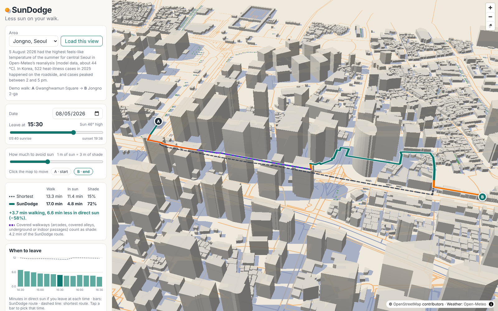

# SunDodge

**Less sun on your walk.**

SunDodge finds a walking route with less direct sun than the shortest one, and shows how the sun on that route changes if you leave a little earlier or later. It works out building and tree shadows from OpenStreetMap and the sun's position for any minute of any day.

It runs in your browser with no backend of its own. It needs no account and no API key. The only network calls are to the public Overpass API (map data, when you load a new area) and Open-Meteo (weather).

**Live demo:** https://abccba100.github.io/sundodge/ · **Demo video:** on the Devpost page · Built 16–20 Oct 2026 for EurekaDev 2026.



## Why

- **Heat-related deaths are rising.** WHO, reporting the 2025 Lancet Countdown: the heat-related death rate has risen 23% since the 1990s. That is an average of about 546,000 deaths a year (2012–2021) [1].
- **In Korea, much heat illness happens outdoors in the afternoon.** Korea's emergency-department surveillance counted 4,460 heat-illness cases in 2025 [2]:
  - 79.2% happened outdoors, and 522 cases (11.7%) on the roadside.
  - 30% of patients were 65 or older.
  - Cases clustered between 2 and 5 pm.
- **Shade changes the heat a body takes in far more than the air temperature does.** On clear days in Tempe, Arizona, shade from buildings and other structures cut mean radiant temperature by about 20–31 °C during the day. Mean radiant temperature is a measure of the radiant heat load on a person. Air temperature in the same places differed by less than 1.3 °C [3].
- **So which side of the street you walk on can matter more than the forecast.**
  - Mainstream navigation apps route by distance or time.
  - A growing number of apps and research tools now route by shade (see Related work).
  - SunDodge is an open, in-browser take on that idea.

## What it does

- **Two routes, compared.**
  - The shortest route is drawn as a dashed line.
  - The SunDodge route is drawn teal in shade, amber when partly sunny, orange in sun, and dashed purple on covered walkways.
  - For each route you see walking time, minutes in direct sun and the share of the walk in shade.
- **Covered walkways are shown separately.**
  - Arcades, covered alleys, building passages and underground or indoor passages count as shade.
  - The app draws them in a different style and tells you how many minutes of the route use them, so you can see how much of the saving comes from them.
- **Your trade-off.** A slider sets how much you want to avoid sun. "1 m of sun = 3 m of shade" means the route will walk up to 3 m further to avoid 1 m of sun. This is the sun-avoidance parameter α from the CoolWalks model [4].
- **When to leave (secondary).**
  - SunDodge recomputes both routes for departures every 10 minutes, one hour either side, and charts the minutes in sun.
  - If timing makes less than a minute of difference, it says so. Usually the route matters more than the time (see Results).
- **Honest about its data.**
  - Not every building in OpenStreetMap has a height. The app shows the share of heights that come from tags.
  - It can colour buildings by data quality: green for a height tag, yellow for floors × 3 m [8], red for an estimate from the building type.
- **Weather context.**
  - Shows feels-like and air temperature and direct radiation for that hour, from Open-Meteo.
  - Past dates use Open-Meteo's reanalysis, which is model data, not a weather station.
  - UV appears on forecast days only.
- **Areas.**
  - Two areas are pre-cached: Jongno (Seoul) and Midtown (New York).
  - "Go to another city…" (or "My location") moves the map, and "Load this view" then fetches that area, up to 2.5 km², from the Overpass API in the place's own time zone.
  - Live loading was tested on the deployed site in London, Tempe (Arizona) and Daejeon (Korea) on 17 Oct 2026.
  - Accuracy depends on how well the area is mapped, which the app shows.

## Results

These numbers come from `npm run evaluate` (scripts/evaluate.ts): 200 random walks per area (seeded), 0.5–1.5 km in a straight line, α = 3. They are model output on OpenStreetMap data: minutes in direct sun as SunDodge computes them, not measured temperatures. The full tables are in [docs/EVALUATION.md](docs/EVALUATION.md).

Median results for leaving at 15:00, with the interquartile range in brackets:

| Area | Shortest route, min in sun | SunDodge route, min in sun | Sun saved | Extra walking | Trips saving ≥ 2 min |
|---|---|---|---|---|---|
| Midtown, New York (2 Jul 2026) | 4.9 | 1.2 | 3.6 min (2.3–5.3), 73% | 0.4 min | 79% |
| Jongno, Seoul (5 Aug 2026) | 10.3 | 7.8 | 2.1 min (1.1–4.1), 21% | 0.8 min | 53% |

What this shows:

- **Seoul gains less than New York.** Most Seoul heights are estimated (13% are tagged, against 90% in Midtown), and the street network is irregular. Without covered walkways the Seoul median saving is 1.4 min; in New York it is 3.2 min.
- **Timing matters less than the route.** The best departure within ±60 min saves a median of 0.6 min of sun on the SunDodge route. It saves at least 1 minute in 30% of Seoul trips and 20% of New York trips.

The demo walks in the app and the video are illustrations, chosen to show the features. They are better than typical:

| Demo walk | Shortest route | SunDodge route |
|---|---|---|
| Penn Station → Rockefeller Center, 2 Jul 2026, 14:00 | 23.4 min, 18.4 min in sun | 24.6 min, 6.6 min in sun (−64%), including 1.9 min on covered ways |
| Gwanghwamun Square → Jongno 2-ga, 5 Aug 2026, 15:30 | 13.3 min, 11.4 min in sun | 17.0 min, 4.8 min in sun (−58%), including 4.2 min in Pimatgol (피맛골), a covered historic alley |

The demo dates had the highest feels-like temperature of summer 2026 for each area in Open-Meteo's reanalysis (about 44 °C).

## How it works

1. **Data.**
   - One Overpass query fetches buildings, walkable ways, trees, parks and water.
   - Building height comes from `height`, then `building:levels` × 3 m, then a default for the building type.
   - `min_height` and `building:min_level` make raised parts such as roofs on pillars.
   - Buildings with a negative `layer` or `location=underground` (subway stations, for example) cast no shadow.
   - Road tunnels are not walkable unless pedestrians are allowed or the "tunnel" is a street running under a mapped building.
   - Covered, indoor and below-ground footways count as shade.
2. **Shadows as a ray test.** This is standard shadow-ray casting, reduced to 2-D segment queries.
   - On flat ground, a point P is in a building's shadow when the ray from P toward the sun passes through the building.
   - For height h, the ray is under the roof for the first L = h / tan(sun altitude) metres. So P is shaded when the segment from P toward the sun, of length L, touches the footprint.
   - This is exact for the model of flat ground, straight-sided buildings and disc-shaped canopies, including concave footprints. Real roofs and terrain are not modelled.
   - A Flatbush R-tree narrows each query to nearby buildings.
   - Trees are canopy discs between a base height and a top height.
3. **Routing.**
   - Every walkway is sampled every 4 m to get its fraction in sun.
   - Dijkstra minimises (metres in shade) + α × (metres in sun) [4].
   - Shadows are evaluated at the middle of the walk. Compared with an edge-by-edge, time-dependent evaluation, this changed the demo walks by about 0.3 min or less.
4. **When to leave.** The worker repeats the comparison for 13 departure times, one at a time, so that moving a slider is never stuck behind the chart.
5. **Checks.**
   - Sun positions agree with NREL's Solar Position Algorithm (via pvlib) within 0.13° for the test cases.
   - `npm test` runs 23 unit tests:
     - sun position;
     - exact shadow reach for box and L-shaped buildings;
     - overhangs;
     - tree shade;
     - night;
     - polar day and night;
     - road-tunnel and underground rules;
     - length parsing;
     - shaded-detour routing;
     - departure-sweep consistency.
   - `npm run lint:areas` flags buildings drawn on top of open streets.

## Related work (selected)

| Project | What it is | How SunDodge differs |
|---|---|---|
| 그늘로 (Seoul, launched Jul 2026) [5] | Shade walking routes in Seoul from building-shadow analysis and the OSM pedestrian network, with Seoul-specific options (detour, slopes, crowding, subway cooling cars) | Focused on Seoul. SunDodge is open source, runs in the browser and can load other cities |
| ShadePath: Comfort Routes [6] | Mobile app with comfort routes using layers such as tree canopy and building shadows, plus a "Best time to head out" planner that ranks hours by shade, heat and UV | SunDodge's method and code are open, and its departure chart re-routes both routes for every 10-minute slot |
| inShade: Shady Walk Routes [7] | Mobile app, 100+ countries, building and tree shade; the route changes as you move the time | Similar idea. SunDodge is open source, shows its data quality and publishes an evaluation |
| Shade Walker (NYC) [9] | Shadiest walking route in New York from NYC tree and building data | Single city with city datasets. SunDodge uses OSM for any area |
| Shade Walk CS (Texas A&M) [10] | Campus shade routing with LiDAR heights and canopy rasters, ray test and Dijkstra | Campus-specific data. SunDodge uses OSM and adds a departure sweep |
| HeiGIT heat-avoiding routing [11] | Open-source, server-based shade routing (openrouteservice) in 80 German cities | SunDodge has no server of its own and fewer data sources |
| ASU Cool Routes [12] | Open-source web tool from Ariane Middel's SHaDE Lab, mean radiant temperature, ASU Tempe campus | Cool Routes models heat load more physically. SunDodge trades that for reach |
| Cool Walks, Barcelona [13] and the CoolWalks model [4] | Barcelona app (LiDAR), and the research model whose α cost SunDodge uses (its study areas include Manhattan) | SunDodge implements the CoolWalks cost interactively in the browser |

**Name note.** The project was called "ShadeWalk" while it was being built. It was renamed SunDodge because several projects already use that name, including Shade Walk CS and Shade Walker above. It is independent of all of them.

## Limitations

- **Heights.**
  - Only 13% of the buildings in the Jongno area have a height or floor count in OSM; the rest are estimated by building type. Seoul results are less certain.
  - Korea's official building register records floor counts and could fill this gap.
- **Model.**
  - The ground is flat, buildings are straight prisms and trees are discs.
  - Drawn shadow outlines are simplified (convex hulls), though the computed shade is exact for the model.
  - Courtyards in multipolygon buildings are not handled.
- **Wide roads.**
  - OSM draws a wide road as one centre line, where the sun is strongest.
  - This can overstate the sun on the shortest route. Sampling at the building line instead changes the Seoul demo saving to about −48…−56%.
- **Trees.** Many cities map only some street trees, so tree shade is undercounted.
- **Covered and underground ways.** These follow OSM tags. A passage might be closed, or (rarely) inside a station's fare area.
- **Live loading.** This depends on the free, volunteer-run Overpass API, which can be slow or busy.
- **Sun, not health.** "Minutes in direct sun" is an exposure measure, not a heat-stress or medical risk score.

## Run it

```bash
npm install
npm run dev          # http://localhost:5173
npm test             # unit tests
npm run evaluate     # regenerates docs/EVALUATION.md
npm run lint:areas   # data check for the bundled areas
npm run build        # static site in dist/
```

To add a pre-cached area: `node scripts/fetch-area.mjs my-area <west> <south> <east> <north>`.

## Data and licences

- **Code.** MIT (see LICENSE).
- **Map data.** © OpenStreetMap contributors, under ODbL 1.0.
  - The files in `public/areas/` are OSM extracts and are licensed under ODbL, not MIT.
  - They were fetched once through the Overpass API, following its usage policy [14].
  - Tags that the first trimming step had dropped (`layer`, `location`, `min_height`, `building:min_level`) were restored on 17 Oct 2026 from a tags-only Overpass query. See `scripts/retag-2026-10-17.json` and `scripts/merge-tags.mjs`.
- **Weather.** Open-Meteo, CC BY 4.0, free for non-commercial use [15]. Past dates use the reanalysis archive.
- **No base-map tiles.** The map is drawn from the downloaded OSM features.

## How this was built (AI use)

I built SunDodge with heavy help from Claude (Anthropic), an AI assistant.

- **What Claude did.**
  - Suggested three project ideas; I chose this one.
  - Wrote most of the code, the tests, this README and the Devpost text.
  - Made the demo video: recording, script and editing. The narration is AI text-to-speech (Kokoro-82M).
  - Ran an AI review ("red team") that checked the claims and the code. The fixes it found are described in the Devpost text.
- **What I did.**
  - Chose the contest and the topic.
  - Made the direction decisions, such as the name, what to claim and which fixes to make.
  - Reviewed the results and tested the app.

## References

1. WHO news release on the 2025 Lancet Countdown report, 29 Oct 2025. https://www.who.int/news/item/29-10-2025-climate-inaction-is-claiming-millions-of-lives-every-year--warns-new-lancet-countdown-report
2. Newsis, 14 May 2026, on KDCA heat-illness surveillance for 2025. https://www.newsis.com/view/NISX20260514_0003629135
3. Middel, A. et al. (2021). 50 Grades of Shade. *Bulletin of the American Meteorological Society* 102(9). https://journals.ametsoc.org/view/journals/bams/102/9/BAMS-D-20-0193.1.xml
4. Wolf, Vierø, Szell. CoolWalks. arXiv:2405.01225. https://arxiv.org/abs/2405.01225
5. Newsis, 6 Aug 2026, on 그늘로. https://www.newsis.com/view/NISX20260806_0003738660
6. ShadePath: Comfort Routes, App Store. https://apps.apple.com/app/id6762091355
7. inShade: Shady Walk Routes, App Store. https://apps.apple.com/app/id6779049186
8. OpenStreetMap Wiki, Key:building:levels. https://wiki.openstreetmap.org/wiki/Key:building:levels
9. Shade Walker. https://shadewalker.nyc/
10. Shade Walk CS (eekimsj/Shade-walk). https://github.com/eekimsj/Shade-walk
11. HeiGIT, heat-avoiding routing, 11 Jun 2026. https://heigit.org/introducing-the-technology-behind-heat-avoiding-routing-how-a-heidelberg-research-initiative-became-a-nationally-scalable-open-source-tool/
12. ASU News, "New Cool Routes app maps the shadiest routes for your walk", 10 Jun 2026. https://news.asu.edu/20260610-environment-and-sustainability-new-cool-routes-app-maps-shadiest-routes-your-walk
13. Freethink, "Cool Walks", 17 Jul 2021. https://www.freethink.com/energy/cool-walks
14. Overpass API usage policy. https://wiki.openstreetmap.org/wiki/Overpass_API
15. Open-Meteo terms. https://open-meteo.com/en/terms
